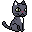
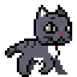
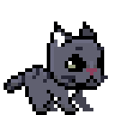
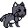
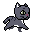

# Pixel Pet

Un gatto in pixel art che vive sul desktop di Windows: salta, cammina, corre dove gli dici, ti saluta con un fumetto e ogni tanto si stufa e graffia.

## Anteprima



| Cammina | Salta | Graffia | Corre |
|:---:|:---:|:---:|:---:|
|  |  |  |  |

## Installazione

Vai alla pagina delle [**Releases**](https://github.com/chiarabis/pixel-pet/releases/latest) e scegli uno dei due file:

| File | Per chi | Come si usa |
|----|----|----|
| `PixelPet-Setup-x.y.z.exe` | Chi vuole installarlo | Fai doppio clic: si installa da solo, senza permessi di amministratore e senza scelte da fare |
| `PixelPet-win32-x64-x.y.z.zip` | Chi lo vuole portatile | Estrai lo zip in una cartella qualsiasi e avvia `PixelPet.exe`, senza installare |

> [!NOTE]
> **Requisiti:**  10 o 11, 64 bit. 

### "Windows ha protetto il PC"

Al primo avvio Windows può mostrare questo avviso blu (SmartScreen). Succede perché il programma non ha una firma digitale a pagamento, **non perché sia pericoloso**: il codice è tutto qui, leggibile da chiunque.

1. Clicca su **Ulteriori informazioni**.
2. Clicca su **Esegui comunque**.

> [!WARNING]
> Alcuni antivirus possono segnalare per errore un programma nuovo e poco diffuso: se succede, è un falso positivo.

## Interazione

Il pet compare in basso a destra dello schermo.

- **Passa il mouse sopra di lui:** compare un cuoricino.
- **Clicca:** salta in avanti.
- **Tieni premuto e trascina:** lo sposti dove vuoi sullo schermo.
- **Troppe coccole:** se lo clicchi tante volte di fila (6), o tieni il mouse fermo su di lui per qualche secondo senza cliccare, si stufa e graffia.
- **Lascialo in pace:** dopo 10 secondi senza che tu tocchi il mouse su di lui, attraversa lo schermo camminando. Ogni tanto si ferma a un bordo a graffiare. Se ci passi sopra con il mouse si ferma, e riparte dopo qualche secondo.
- **Tasto destro:** apre il menu.
  - **Giochiamo:** clicca un punto qualsiasi dello schermo e il pet ci corre. `Esc` annulla.
  - **Fammi parlare:** scrivi una frase di al massimo 6 parole e il pet la ripete in un fumetto ogni 10 secondi. Passando il mouse sul fumetto compare una **✖️** per toglierlo.
  - **Sempre in primo piano:** se è **✔️** la finestra del pet resta in primo piano.
  - **Crediti:** chi ha disegnato gli sprite.
  - **Esci:** chiude Pixel Pet.

## Come disinstallare

- **Installato con il Setup:** Impostazioni → App → App installate → PixelPet → Disinstalla.
- **Versione portatile:** chiudi il pet dal menu (tasto destro → Esci) ed elimina la cartella.

## Privacy

Pixel Pet non raccoglie né invia nessun dato e non si collega a internet. Gli unici link sono quelli nella finestra dei crediti, che si aprono nel browser solo se li clicchi.

## Per sviluppatori

Il progetto usa Electron, React e Vite, ed è impacchettato con [Electron Forge](https://www.electronforge.io/).


```bash
npm install
npm run dev
```

Per creare installer e zip (in `out/make/`):

```bash
npm run make
```

> Se il percorso della cartella del progetto contiene caratteri speciali (per esempio un'emoji), la creazione dell'installer Windows fallisce: gli strumenti di Squirrel non li leggono. In quel caso usa `npm run make:win`, che costruisce da una copia temporanea in un percorso semplice e riporta i file in `out/make/`.

Struttura di `electron/`: 
  - `movement/` (trascinamento, salto, camminata, corsa),
  - `play/` ("Giochiamo"),
  - `bubble/` ("Fammi parlare"),
  - `credits/`.

## Crediti e licenze

**Gatto grigio** (sprite): *Gray cat asset pack* di Krystsina Staselovich, [OpenGameArt](https://opengameart.org/content/gray-cat-asset-pack), licenza [CC BY 4.0](https://creativecommons.org/licenses/by/4.0/). Gli sprite sono ingranditi e a volte specchiati.

Il dettaglio è in [CREDITS.md](CREDITS.md) e nel menu **Crediti** dell'app.

Il **codice** di Pixel Pet è sotto [licenza MIT](LICENSE). 
Gli **sprite** restano soggetti alle licenze dei rispettivi autori e non sono coperti dalla licenza MIT. Pixel Pet non è approvato né sostenuto dagli autori degli sprite.

---


[](https://opensource.org/licenses/MIT)
